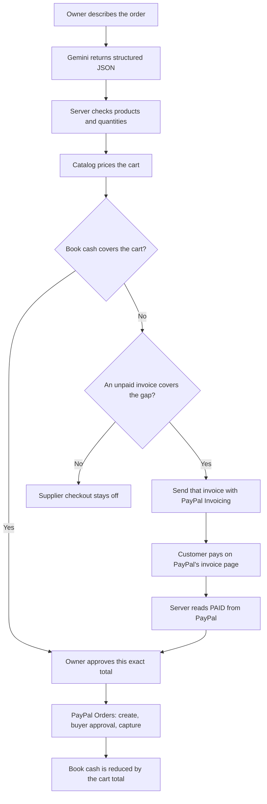
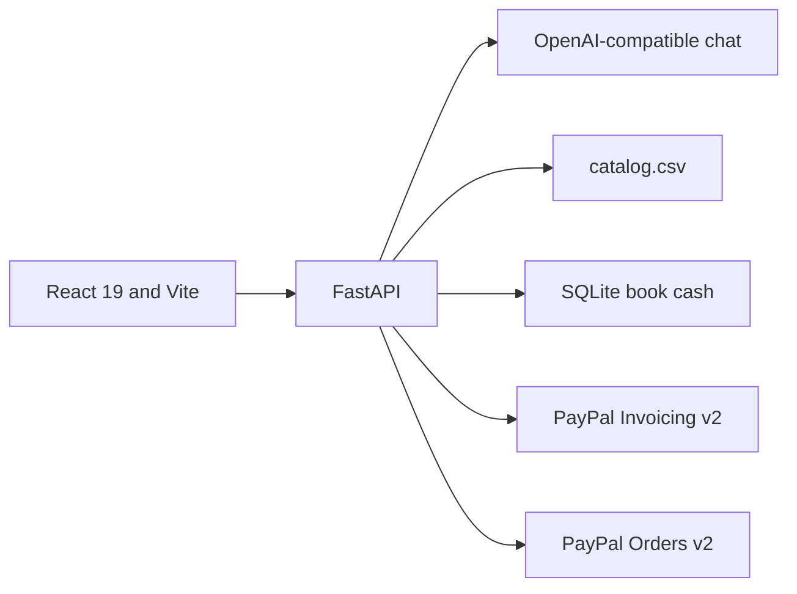
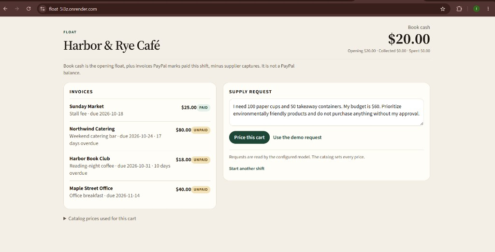
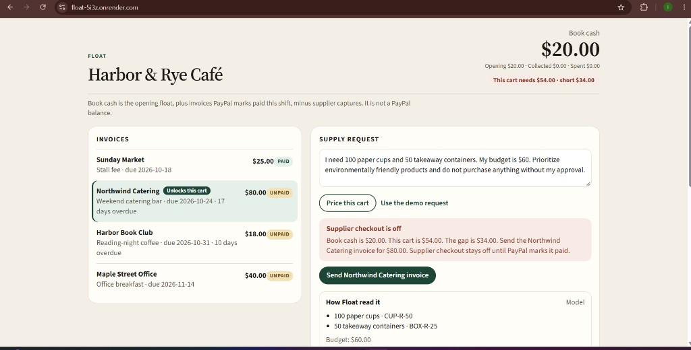
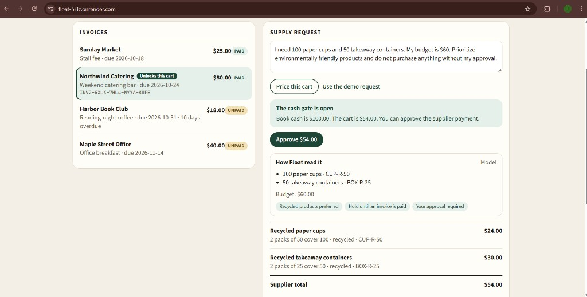
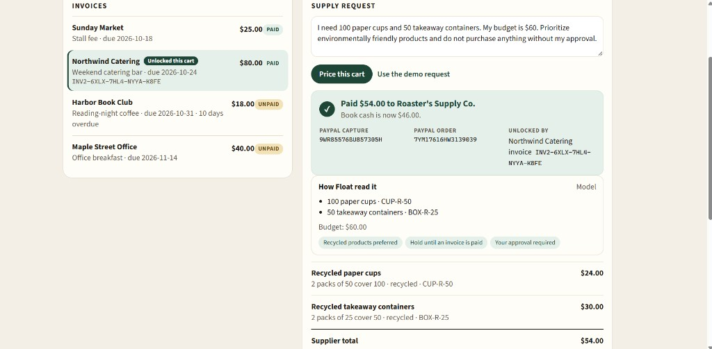

# FLOAT

**Don't pay the supplier until the customer pays you.**

Float is a cash-flow-aware procurement agent for a small café. The owner describes a supply order in plain language. Float prices that order from its own catalog, compares the total with book cash, and keeps the PayPal supplier payment blocked until PayPal confirms that the customer invoice covering the gap is paid. The owner then approves that exact cart, and PayPal captures the supplier payment.

The model reads the request. The server decides the money.

[](https://www.python.org/)
[](https://fastapi.tiangolo.com/)
[](https://react.dev/)
[](https://ai.google.dev/)
[](https://developer.paypal.com/)
[](LICENSE)

**Live Demo:** [float-5i3z.onrender.com](https://float-5i3z.onrender.com)

**YouTube Demo:** Coming soon

**Repository:** [github.com/ishagupta0506/Float](https://github.com/ishagupta0506/Float)

**What Float does**

- Reads a plain-language supply order and matches it to the café catalog.
- Prices every line from `catalog.csv`. The model never sets a price.
- Blocks supplier checkout while book cash is short, and names the unpaid invoice that covers the gap.
- Sends that invoice with PayPal Invoicing and waits until PayPal reports it paid.
- Requires the owner's approval, then captures the supplier payment with PayPal Orders.
- Shows the capture ID, order ID, and the invoice that unlocked the cart, with an audit list of each check.

| What Float does | What Float refuses to do |
| --- | --- |
| Read a purchase request and match it to the catalog | Let the model set a price |
| Hold supplier checkout while book cash is short | Create a supplier order before the covering invoice is paid |
| Send and re-check a real PayPal Sandbox invoice | Treat book cash as a PayPal or bank balance |
| Capture a supplier payment only after the owner approves that cart | Ship goods. The catalog is local data |

## The problem

A café often has to pay for cups, containers, and coffee before the catering client pays the invoice for last weekend. The money is coming. It is not here yet.

Buying against that gap creates cash-flow pressure. A purchasing assistant can pick products and even stay under a budget, and still send the supplier payment on a day the till cannot cover. The missing piece is not another product suggestion. It is a rule that outgoing cash waits for incoming cash.

## The solution

Float ties one outgoing supplier payment to one incoming customer payment.

1. The owner states the order, the budget, and any constraint such as recycled products or "do not pay until I approve."
2. Float builds one cart from `backend/data/catalog.csv` and prices every line itself.
3. If book cash is short, Float selects an unpaid customer invoice large enough to close the gap and sends it through PayPal.
4. Supplier checkout stays off. Float polls PayPal until that invoice is paid.
5. The owner approves the exact total. Only then does PayPal create and capture the supplier order.

A shopping assistant stops at the cart. Float stops the payment.

## How it works



Book cash is the opening float, plus invoices PayPal marks paid in this shift, minus supplier captures. The UI says this in the same words. It is not the café's PayPal balance.

While a sent invoice is still unpaid, the page checks PayPal about every four seconds. A paid status is accepted only when PayPal reports `PAID` or `MARKED_AS_PAID`.

## The demo scenario

The seeded café opens with **$20.00** book cash. Sunday Market is already paid and does not count toward this shift. Three invoices are still unpaid. The button **Use the demo request** fills in:

> I need 100 paper cups and 50 takeaway containers. My budget is $60. Prioritize environmentally friendly products and do not purchase anything without my approval.

| Step | What happens | Book cash |
| --- | --- | ---: |
| Open the shift | Opening float only | $20.00 |
| Price the cart | 2 packs of recycled cups at $12.00 each, and 2 packs of recycled containers at $15.00 each | $20.00 |
| Cash check | Cart is $54.00. The gap is $34.00. Harbor Book Club is $18.00, so it cannot cover the gap. Northwind Catering is $80.00 and is the most overdue invoice that can. | $20.00 |
| Checkout | Supplier checkout stays off. Float offers **Send Northwind Catering invoice**. | $20.00 |
| Customer pays | PayPal marks the $80.00 invoice paid. Float adds it to this shift. | $100.00 |
| Owner approves | **Approve $54.00** records approval of this cart. No money moves yet. | $100.00 |
| Supplier capture | PayPal captures $54.00 to Roaster's Supply Co. | $46.00 |

$20.00 + $80.00 − $54.00 = **$46.00**. The receipt shows the amount, the supplier, the PayPal capture ID, the PayPal order ID, and the Northwind invoice that unlocked the cart.

## Technology and architecture



| Piece | What it actually does |
| --- | --- |
| React 19 and Vite | One page. The production build is written to `backend/app/static` and served by FastAPI. |
| FastAPI | `/api/state`, `/api/purchases`, invoice send, approval, order creation, capture, and a new shift. `/api/health` returns `{"ok": true}`. |
| Purchase reader | `POST {LLM_BASE_URL}/chat/completions` with JSON mode. The hackathon configuration points this at Gemini 2.5 Flash. If the call fails, a deterministic reader is used and the cart says so. |
| Catalog | `backend/data/catalog.csv`. SKU, pack size, price in cents, recycled flag, and supplier. One supplier per cart. |
| SQLite | `backend/data/float.db`. Shifts, invoices, carts, and an audit list. Created on startup if it is missing. |
| PayPal | Two sandbox REST apps. The café app uses Invoicing v2. The supplier app uses Orders v2. |

## Gemini and financial safety

Gemini's job is to turn a sentence into a small JSON object: product words, an optional catalog SKU, a quantity, a unit, a budget, a recycled preference, and whether the owner asked to wait for an invoice. The catalog sent with that call has SKUs, names, pack sizes, and a recycled flag. It has no prices.

Everything after that JSON is Python.

| Decision | Who makes it |
| --- | --- |
| Which products and quantities were asked for | The model, then checked again by the server |
| Whether a SKU exists, and whether it matches the words | The server. A SKU that contradicts the words is rejected. |
| The price and the cart total | `catalog.csv` only. Price-like fields in the model output are dropped and noted. |
| Which budget applies | The amount written in the request. If the model read a different number, the typed amount wins. |
| Another currency | Rejected. The catalog is priced in US dollars. |
| An ambiguous phrase such as "10 bags" | Not guessed. Float asks which product. |
| Over budget | The cart is kept as asked and marked over budget. Items are not silently removed to fit. |
| Approve, pay, capture, or mark an invoice paid | Impossible through model output. Those fields are ignored. Each action is its own server route. |
| Owner approval | Always required. The server sets this itself. The model cannot switch it off. |

Approval, order creation, and capture each re-check the cash gate. `backend/tests/test_ai_bypass.py` feeds hostile model output and checks that no order is created, nothing is captured, book cash is unchanged, and the covering invoice stays unpaid.

This split is the product. A fluent reading of "100 paper cups" is useful. A fluent reading is not a reason to move money.

`AI_MODE` selects the reader:

| Mode | Behavior |
| --- | --- |
| `auto` | Use the model when `LLM_API_KEY` is set. Otherwise use the mock reader. This is the default. |
| `llm` | Use the model. If the key is empty, use the mock reader and show a warning. |
| `mock` | Never call the network. The tests use this mode. |

The request asks for `response_format: {"type": "json_object"}` and stops after 20 seconds. A timeout or a non-JSON reply falls back to the mock reader, and the audit list records that the model call failed.

## Real PayPal integration

Float uses the PayPal Sandbox, at `PAYPAL_BASE_URL=https://api-m.sandbox.paypal.com`. These are live sandbox API calls, not a simulated payment widget. They are not live-merchant charges.

Two REST apps, on two sandbox business accounts, stay separate.

**Customer cash, café app.** Invoicing v2.

- `POST /v2/invoicing/invoices` creates the invoice.
- `POST /v2/invoicing/invoices/{id}/send` sends it to `CLIENT_PAYER_EMAIL`.
- `GET /v2/invoicing/invoices/{id}` is how Float learns the status.
- The customer pays on PayPal's hosted invoice page. Float does not collect card details.

The invoice note states which supply order is being held. PayPal does not reliably keep custom text on reminder mail, so the note is written on the invoice itself.

**Supplier cash, supplier app.** Orders v2.

- `POST /v2/checkout/orders` creates the order only after the owner has approved and book cash still covers the cart.
- The PayPal JavaScript button, loaded with the supplier app's client ID, is where the buyer approves.
- `POST /v2/checkout/orders/{id}/capture` captures the payment to the supplier app's merchant account.
- The capture ID and order ID are stored and shown on the receipt.

OAuth uses each app's client ID and secret. A failed or unreachable PayPal call returns an error and does not mark the cart paid.

## Security and financial integrity

- PayPal and the model are called from the server. The browser never sees a client secret or the Gemini key.
- Credentials live in environment variables. `.env` is gitignored. `.env.example` ships with empty values.
- The cash gate is checked again on approve, on order creation, and on capture. A blocked cart cannot open a supplier order by calling the route directly.
- Approval is an explicit `POST /api/purchases/{id}/approve`. The model has no approval field that the server honors.
- Each cart keeps an audit list: catalog pricing, the invoice that was chosen, the owner's approval, PayPal's paid status, and the capture.
- Unknown model fields, including anything that looks like a price, an approval, or an invoice status, are discarded.

## Application screenshots

These frames are from the live sandbox demo. Northwind is highlighted on the priced cart and again on the receipt, so those two shots also show the invoice that unlocks the purchase.

### Opening



Book cash **$20.00**, Northwind unpaid, and the demo request in the box.

### Priced and blocked



**Model**, a **$54.00** cart, **short $34.00**, and **Send Northwind Catering invoice**.

### Unlocked



Book cash **$100.00** and **Approve $54.00**.

### Receipt



**$54.00** to Roaster's Supply Co., book cash **$46.00**, the capture ID, the order ID, and the Northwind invoice.

## Quick start

You need Python 3, Node.js, and two sandbox business accounts plus two sandbox personal accounts from the [PayPal Developer Dashboard](https://developer.paypal.com/dashboard/accounts).

| Account | Type | Role |
| --- | --- | --- |
| Café | Business | Its REST app sends the customer invoice |
| Supplier | Business | Its REST app creates and captures the supply order. The capture pays this account. |
| Catering client | Personal | Pays the invoice. This address is `CLIENT_PAYER_EMAIL`. Sign in as this account to pay. |
| Café owner | Personal | Approves the cart in Float and pays in the PayPal button |

Create one REST app on the café business account and one on the supplier business account.

```bash
cp .env.example .env
```

On Windows PowerShell, copy the file with `Copy-Item .env.example .env`. Fill in the values. Do not commit `.env`.

| Variable | Purpose |
| --- | --- |
| `CAFE_PAYPAL_CLIENT_ID` | Café sandbox app |
| `CAFE_PAYPAL_CLIENT_SECRET` | Café sandbox app |
| `CAFE_MERCHANT_EMAIL` | Café sandbox business email, if PayPal requires an invoicer |
| `SUPPLIER_PAYPAL_CLIENT_ID` | Supplier sandbox app |
| `SUPPLIER_PAYPAL_CLIENT_SECRET` | Supplier sandbox app |
| `CLIENT_PAYER_EMAIL` | Sandbox personal account that receives and pays the invoice |
| `AI_MODE` | `auto`, `mock`, or `llm` |
| `LLM_API_KEY` | Key for the chat endpoint |
| `LLM_BASE_URL` | OpenAI-compatible base URL |
| `LLM_MODEL` | Model name on that endpoint |
| `STARTING_CASH_CENTS` | Opening book cash. `2000` is $20.00 |
| `PAYPAL_BASE_URL` | `https://api-m.sandbox.paypal.com` |

`.env.example` points the reader at Groq. For the Gemini configuration used in this submission, set:

```bash
AI_MODE=auto
LLM_BASE_URL=https://generativelanguage.googleapis.com/v1beta/openai
LLM_MODEL=gemini-2.5-flash
```

Put the Gemini key in `LLM_API_KEY`. Leave the other lines as you filled them.

Backend. Create the virtual environment from `backend`:

```bash
cd backend
python -m venv .venv
```

Activate it in Windows PowerShell:

```powershell
.\.venv\Scripts\Activate.ps1
```

Activate it on macOS or Linux:

```bash
source .venv/bin/activate
```

Then, in that same terminal:

```bash
pip install -r requirements.txt
python scripts/check_paypal.py  # confirms both sandbox apps can obtain a token
python -m pytest -q
```

Frontend, from the repository root:

```bash
cd frontend
npm install
npm run build
```

The build writes the page into `backend/app/static`, which git ignores.

Run the app:

```bash
cd backend
uvicorn app.main:app --port 8000
```

Open http://127.0.0.1:8000. For UI work, run `npm run dev` in `frontend` and open http://localhost:5173. Vite proxies `/api` to port 8000, so the backend still has to be running.

## Demo guide

1. Open the app. Book cash is **$20.00**. Click **Use the demo request**, then **Price this cart**.
2. Confirm **Model** in **How Float read it**, a **$54.00** total, and supplier checkout off. The next action is **Send Northwind Catering invoice**.
3. Send it, then click **Open the PayPal invoice**. In a second browser profile, sign in as `CLIENT_PAYER_EMAIL` and pay the invoice. Sandbox balances are not real charges.
4. Return to Float. Within a few seconds book cash becomes **$100.00** and **Approve $54.00** appears. If it does not, click **Check payment now**.
5. Approve. Pay with the PayPal button as the café owner. The receipt shows the capture ID, the order ID, and book cash of **$46.00**.

**Start another shift** zeroes this shift's collected and spent totals. If the covering invoice is already paid, Float adds a new unpaid copy so the demo can run again. That leaves the paid invoice in the list. For a clean opening screen, stop the server and delete `backend/data/float.db`. The next startup recreates the four seed invoices and the $20.00 float. Deleting the file does not delete PayPal Sandbox invoices or captures.

## Limitations

- Book cash is Float's ledger for this shift. It is not a PayPal balance, a bank balance, or a forecast.
- The supplier catalog is a CSV checked into the repository. No warehouse and no shipment exist behind it.
- Payments run in the PayPal Sandbox. This repository is not a live-merchant integration.
- Customer invoices start as local seed rows. They become PayPal invoices only when the owner sends one.
- One SQLite file stores the demo. On a host whose disk is wiped on restart, such as Render's free web service without a persistent disk, a restart returns the site to the $20.00 opening. Visitors share that one ledger.
- The reader can fall back to the mock parser. When that happens, the cart says the model call failed instead of pretending the model ran.

## Roadmap

None of the following is in the current build.

- A ledger per business, so a public demo is not one shared cart.
- A hosted database that survives restarts.
- PayPal live mode, after the sandbox flow is the one a real café would trust.
- Invoices imported from the café's own receivables, instead of the four seed customers.
- More than one supplier on a cart. Float currently rejects that on purpose and pays one supplier per order.

## License

MIT. See [LICENSE](LICENSE).
